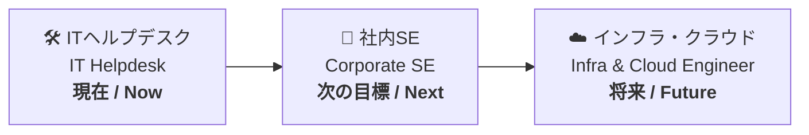
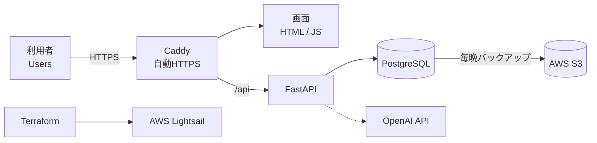
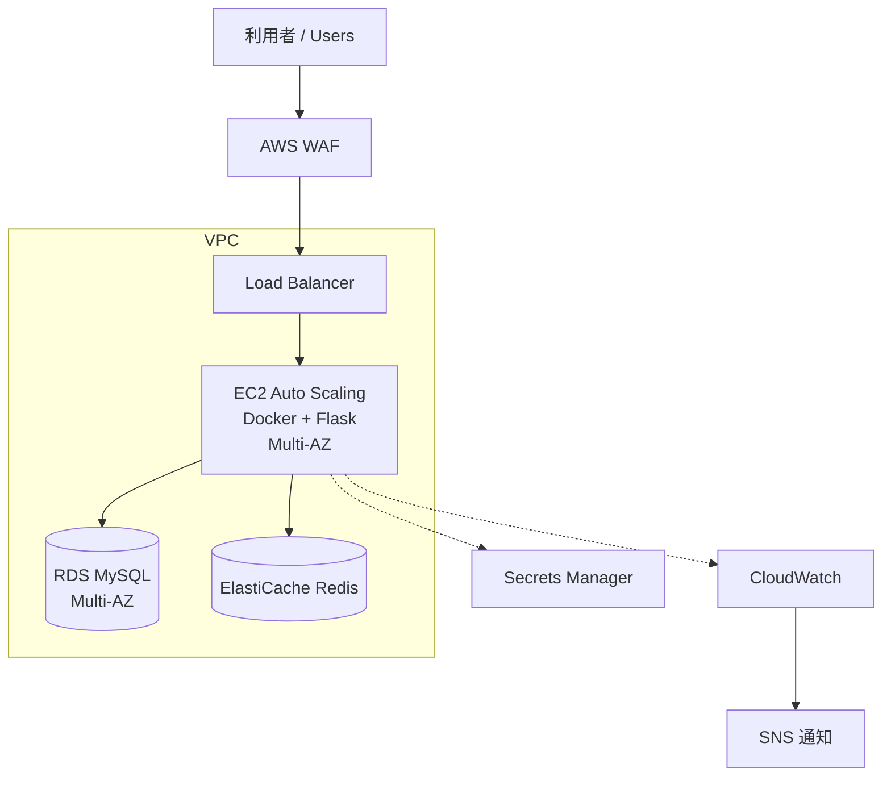
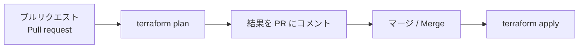

# Tamang Amish（タマン アミス）

### ITヘルプデスク・社内SE ／ インフラ・クラウドエンジニア志望
### IT Helpdesk & Corporate SE ／ Aspiring Junior Infrastructure & Cloud Engineer

📍 Yokohama, Japan　|　🇯🇵 日本語（ビジネス）　|　🇬🇧 English　|　🇳🇵 नेपाली

---

## 👋 自己紹介 / About me

横浜で ITヘルプデスクとして働いています。社内の問い合わせ対応、Windows Autopilot と Microsoft Intune を使った PC・スマートフォンのキッティング、IT資産管理が毎日の仕事です。

現場で感じた「端末の管理が Excel や担当者の記憶に散らばっている」という課題を、自分でシステムを作って解決してきました。次は、社内SE として、そしてインフラ・クラウドの分野で、この経験を活かしたいと考えています。

I work in IT helpdesk in Yokohama: first-line support, device kitting with Windows Autopilot and Microsoft Intune, and IT asset management. I build systems with Python, AWS and Terraform to fix the problems I see at work. My goal is a corporate SE role, growing into infrastructure and cloud.

---

## 🧰 スキル / Skills

**端末管理・社内IT / Device management & corporate IT**

**クラウド・インフラ / Cloud & infrastructure**

**開発 / Development**

| 分野 / Area | 実務 / At work | 個人開発 / In my projects |
|---|---|---|
| 端末管理 / Devices | Intune・Autopilot の登録プロファイル設定、キッティング、共用端末の初期化と再設定 | 端末ライフサイクル管理システムを開発 |
| 社内IT / Corporate IT | 問い合わせ対応、IT資産管理（kintone、Kizuku）、OBIC7 のデータ移行支援 | 問い合わせ管理、FAQ、AIヘルプデスク |
| クラウド / Cloud | 学習中 / learning | AWS（VPC, EC2, ALB, RDS, ElastiCache, S3, IAM, Lightsail, CloudWatch） |
| IaC・自動化 / IaC & automation | Excel（VLOOKUP、ピボット、VBA） | Terraform、GitHub Actions、Docker Compose、バックアップの自動化 |
| 運用ドキュメント / Ops docs | 作業手順の統一と新人教育 | 構築手順書・運用手順書・障害対応手順書（日本語） |

---

## 🚀 プロジェクト / Projects

### 1. 🖥️ Bilingual ITSM Device Management System

**日英対応 IT資産・ヘルプデスク管理システム**　|　[📂 リポジトリを見る / View repository](https://github.com/amishanita/bilingual-itsm-device-management-system)

会社の PC・スマートフォン・タブレットを、調達からキッティング、配布、貸出、返却、データ消去、廃棄まで一元管理するシステムです。私が毎日やっているヘルプデスクの仕事を、そのままシステムにしました。

A system that manages company devices through their whole lifecycle, plus the helpdesk work around them. It is built from the work I do every day.

| 684 | 49 | 13 | 12 | 2 |
|:---:|:---:|:---:|:---:|:---:|
| 自動テスト automated tests | API | テーブル DB tables | 画面 screens | 言語 languages |

**主な機能 / Key features**

- ✅ キッティングのチェックリスト（Autopilot / Intune、iPhone、Android、共用端末）。全手順が終わるまで「準備完了」にできません
- 🔁 端末のライフサイクル管理。データ消去を飛ばして在庫に戻すことはできません
- 📅 期限付きの貸出管理。期限超過は赤で表示
- 👋 退職者処理。その人が持っている端末をすべて一覧にして回収
- 🎫 問い合わせ管理と日英20件の FAQ
- 🤖 OpenAI API を使った AI ヘルプデスク。利用者が確認してから問い合わせを登録
- 🔐 4つのロール（システム管理者、IT管理者、マネージャー、一般社員）と参照範囲の制御
- 📋 すべての変更を記録する監査ログ

<table>
<tr>
<td width="50%"> 端末詳細とキッティングチェックリスト / Device page and kitting checklist</td>
<td width="50%"> 貸出管理（期限超過は赤） / Loans, overdue in red</td>
</tr>
</table>

**構成 / Architecture**

`Python` `FastAPI` `PostgreSQL` `Docker Compose` `Caddy` `Terraform` `AWS Lightsail / S3 / IAM / Budgets` `GitHub Actions` `OpenAI API`

---

### 2. ☁️ AWS 3-Tier Web Application

**AWS 3層 Webアプリケーション**　|　[📂 リポジトリを見る / View repository](https://github.com/amishanita/aws-3tier-webapp)

Terraform で AWS に3層構成の Web アプリケーション環境を作りました。止まりにくい構成（Multi-AZ）、セキュリティ、監視、自動デプロイまでを1つにまとめています。

A 3-tier web application on AWS built with Terraform, covering high availability, security, monitoring and automated deployment.

| ポイント / Highlight | 内容 / Details |
|---|---|
| 🏗️ IaC | dev と prod を Terraform で分離。state は S3 と DynamoDB で管理 |
| 🔐 セキュリティ | WAF、Secrets Manager、最小権限のセキュリティグループ。DB はインターネットから接続不可 |
| 📈 監視 | CloudWatch のカスタムメトリクスとアラーム、SNS で通知 |
| 🚚 CI/CD | GitHub Actions → ECR → CodeDeploy。本番は手動承認のあとにデプロイ |

`Terraform` `VPC` `ALB` `EC2 Auto Scaling` `RDS` `ElastiCache` `WAF` `Secrets Manager` `CloudWatch` `CodeDeploy` `Docker`

---

### 3. 🏗️ Terraform Multi-Environment Infrastructure

**Terraform による開発・本番環境の AWS インフラ**　|　[📂 リポジトリを見る / View repository](https://github.com/amishanita/terraform-multi)

開発環境と本番環境を Terraform で分けて管理し、GitHub Actions で変更内容の確認から反映までを自動化しました。

Separate dev and prod AWS environments in Terraform, with plan on pull request and apply on merge.

| 項目 / Setting | Dev | Prod |
|---|---|---|
| EC2 | t3.micro | t3.medium |
| RDS | db.t3.micro | db.t3.small（Multi-AZ） |
| 削除保護 / Deletion protection | なし | あり |

`Terraform` `VPC` `EC2` `RDS MySQL` `S3` `DynamoDB` `IAM` `GitHub Actions`

---

### 4. 🗂️ Sports Task Manager

**多言語対応のタスク管理アプリ**　|　[📂 リポジトリを見る / View repository](https://github.com/amishanita/sports-task-manager)

練習や試合の予定を管理するシンプルな Web アプリです。日本語・英語・ネパール語を画面上で切り替えられます。フレームワークを使わず、JavaScript の基本から作りました。

A simple task app with Japanese, English and Nepali switching, built in plain JavaScript.

`HTML` `CSS` `JavaScript` `LocalStorage`

---

## 💼 職歴 / Experience

| 期間 / Period | 仕事 / Role | 内容 / Work |
|---|---|---|
| 2025.06〜現在 | **ITヘルプデスク・テクニカルサポート** IT Helpdesk / Tech Support | 問い合わせ対応と切り分け、Intune・Autopilot によるキッティング、IT資産管理、OBIC7 のデータ移行支援、購買事務 |
| 2023.12〜2025.05 | **テクニカルサポート**（携帯ショップ） Technical Support | 端末不具合の切り分け、初期設定、データ移行 |
| 2021.04〜2023.12 | **品質管理・出荷前検査／チームリーダー** Quality Control / Team Leader | 検査と記録、不良の報告、15名のチーム管理と新人教育、作業手順の改善 |

---

## 🎓 学歴・資格 / Education & certifications

- 🎓 四日市情報外語専門学校　情報実務学科 コンピュータ技術者専攻（専門士）　2021年3月卒業
- 🎓 Tribhuvan University（ネパール）　Bachelor of Business Studies　2018年卒業
- 📝 BJT ビジネス日本語能力テスト 420点
- 📝 JPT 620点
- 🚗 普通自動車第一種運転免許

---

## 🎯 希望 / What I'm looking for

| | |
|---|---|
| 職種 / Role | ITヘルプデスク、社内SE・情報システム、インフラ運用・保守、ジュニアクラウドエンジニア |
| 勤務地 / Location | 神奈川県、東京都、千葉県、埼玉県 |
| 入社可能日 / Available | 2026年12月から |

**お気軽にご連絡ください / Feel free to get in touch**

